## 10月12号 第一版

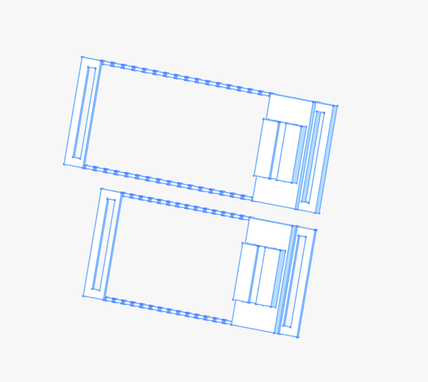

第一版本主要测试 3D 打印在柔性表面的工艺。

**01 工艺说明**

工艺可以参考：[优雅的蕾丝薄纱信封标签](https://makerworld.com.cn/zh/models/2611316-you-ya-de-lei-si-bo-sha-xin-feng-biao-qian?from=search#profileId-3044359)

主要的技术要点就是在<u>打印一层</u>之后「暂停」。这个暂停在拓竹的切片软件中可以添加。

**02 自动化需求和可能性研究**

考虑到进一步降低操作门槛（简化操作），让 柔性面料基底的 3D 打印 可以进一步批量生产，软件自动化流程中主要需要解决两个问题：

1. 添加暂停：支持纱布嵌入
2. 自动支撑：在纱布嵌入的要求下还要支持结构完整性

如果不考虑完整的自动支撑，纱布可能会和支撑打架，导致无法方便拆下支撑。

暂停功能和支持功能，在拓竹切片应用中都有，大致操作如下：

1. 暂停：切片后，在右侧对应层中添加暂停。
2. 支撑：
   1. 前期结构设计就需要考虑3D打印工艺
   2. 尽量使用普通紧凑支撑
   3. 对于内部复杂结构，尽量使用45度免支撑，或桥接。

## 10月13号第二版

第二版主要测试材料柔韧性和强度。

柔韧性要求是因为要和肌肤接触。

强度要求是结构需要拓展。

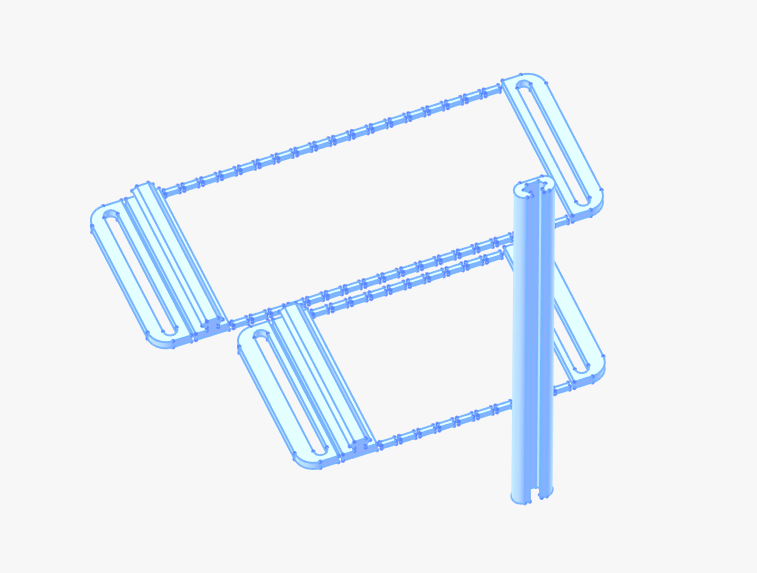

如上图，长条状的结构最终设计是放在手部。如下图所示

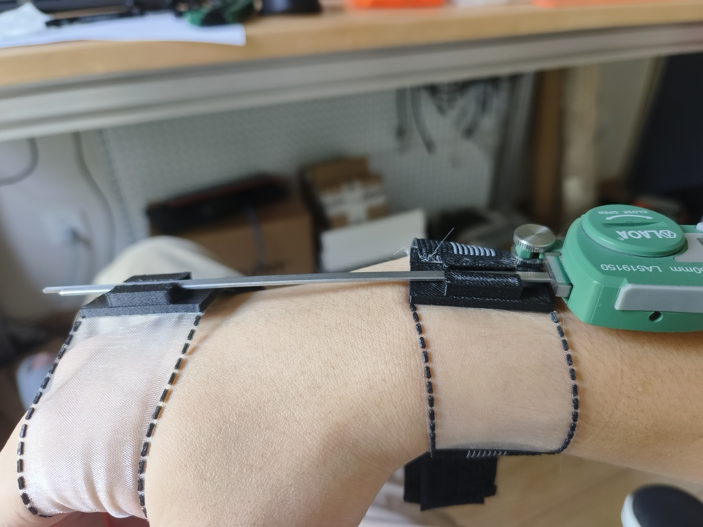

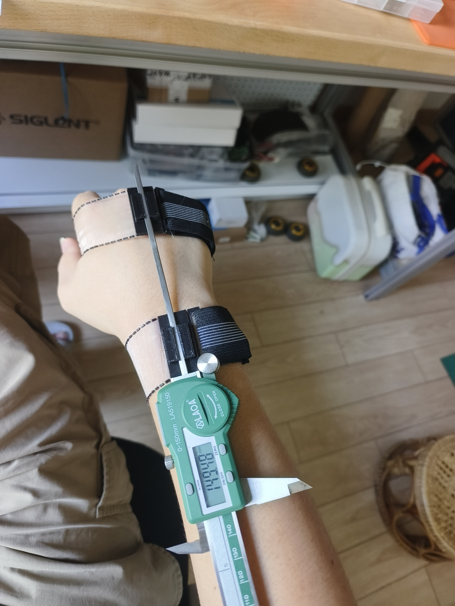

经过测试感受，2mm 厚的 PLA 就足够硬，可以被松紧带拉动。而 3mm 高度的仿皮卡汀尼导轨结构强度足够外挂设备。

## 10-13第三版

第三版解决的问题，主要是手部贴合度。

手腕的佩戴没有难度，但是手掌手背的佩戴和固定应该如何设计才能舒适。这在先前并没有柔性 3D 打印可以参考。

我们首先了解了淘宝上腱鞘炎辅助腕带的设计。但最好的参考还是拳击手绑带的缠绕法：[如何绑缠手带](https://www.bilibili.com/video/BV1c4421S72o/?spm_id_from=333.337.search-card.all.click&vd_source=b736aa3d7f0fdf47b59ea3021dc810ab)

会发现拳击手的绑带会用非常多的腕部借力，而且都会借用鱼际和虎口做固定。

在初步了解腱鞘炎腕带设计和拳击手绑带设计，后续又进一步了解手部肌肉分布。可以参考这个视频：[手部解剖结构讲解](https://www.bilibili.com/video/BV1mu411U7bk/?spm_id_from=333.337.search-card.all.click&vd_source=b736aa3d7f0fdf47b59ea3021dc810ab)

对结构有所了解会对后续的设计细节有更多的理解。

最后还有一张手部参考图：

在这些知识的基础上，我们设计了第三版本：

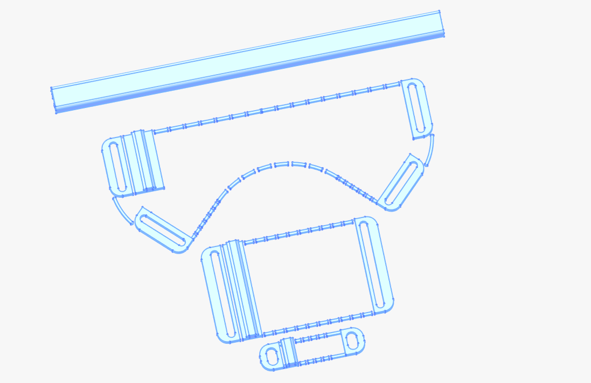

这个版本主要测试手部包裹性、更新了支撑条强度。

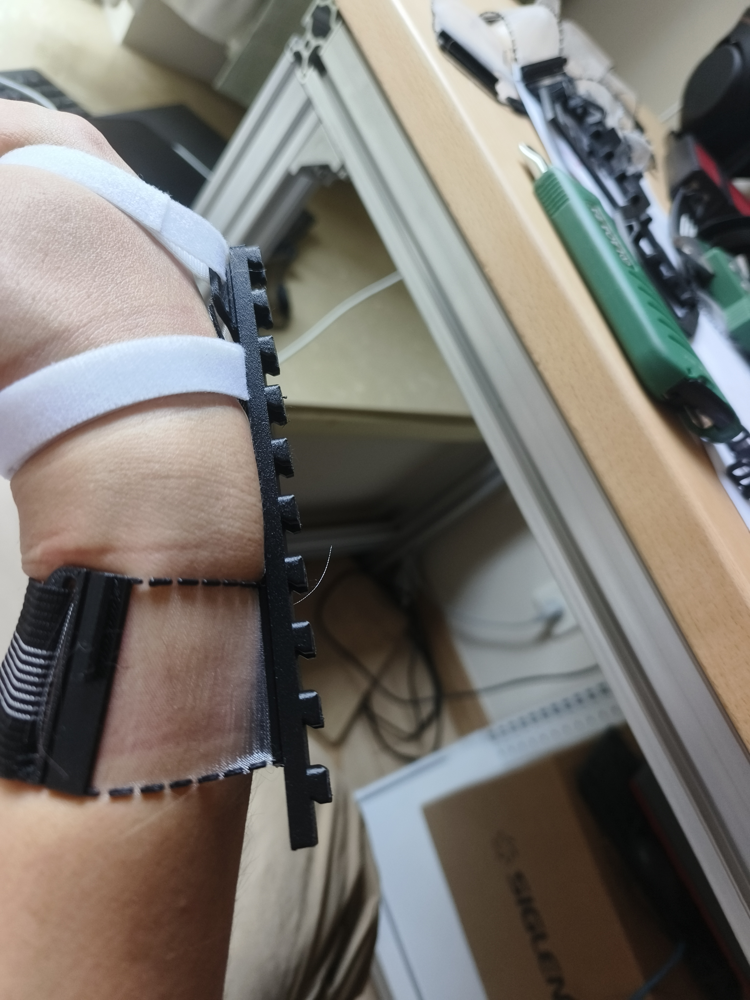

可以看到，柔性面料会被结构拉起，然后再带动腕部的结构。手腕中心会天然形成一个杠杆。这个横梁的总厚度是5.5mm，有效厚度是2.5mm。

另外，这个版本的手部包裹性良好，但不能适配各个手指。

最后，中心最大的有弧线的结构，是手心的佩戴结构，采用了45度角构成大鱼际区的绑定固定，测试后是有效设计——虎口和大鱼际的双重固定让这个区域的结构变的稳定。这个也是参考了上面腱鞘炎和拳击手绑手得到的结果。

但小鱼际部分的收口设计糟糕，会导致小鱼际处受到挤压，产生勒痕。

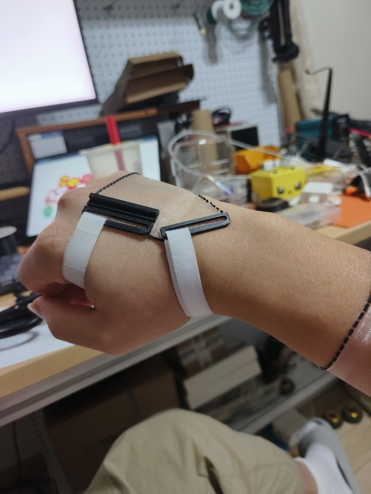

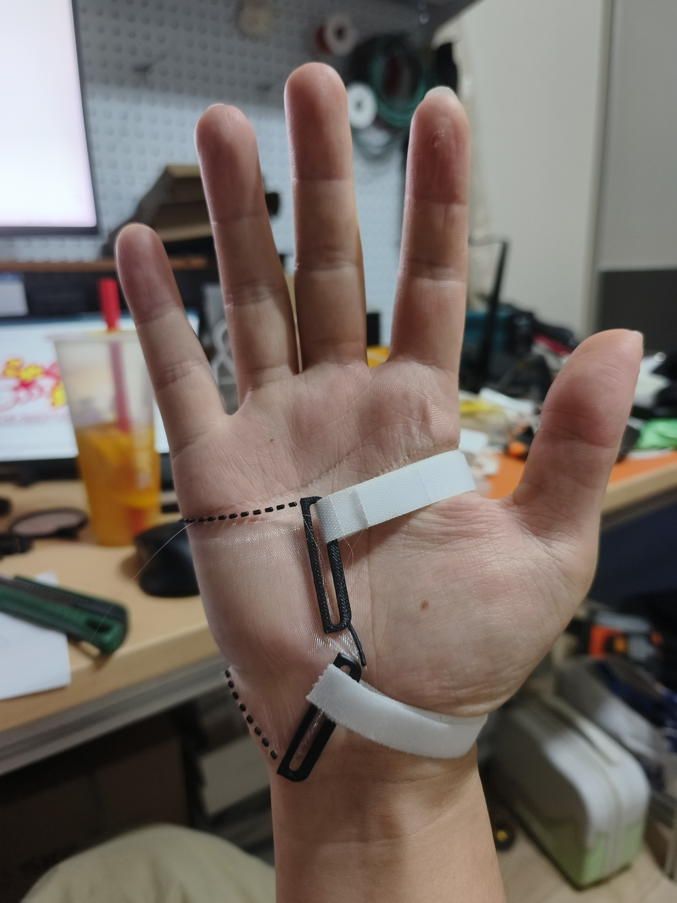

而且，经过测试发现，纱布的抗撕裂性非常差。所以上面显示的虚线形设计，在有横向受力的情况下是不可取的。

## 10 月 14 号 第四版

第四版主要希望解决以下问题：

1. 间隔设计不抗撕裂
2. 小鱼际区的拉扯问题
3. 适配上一代辅具的快拆卡扣结构。
4. 测试手心部分的结构可能性

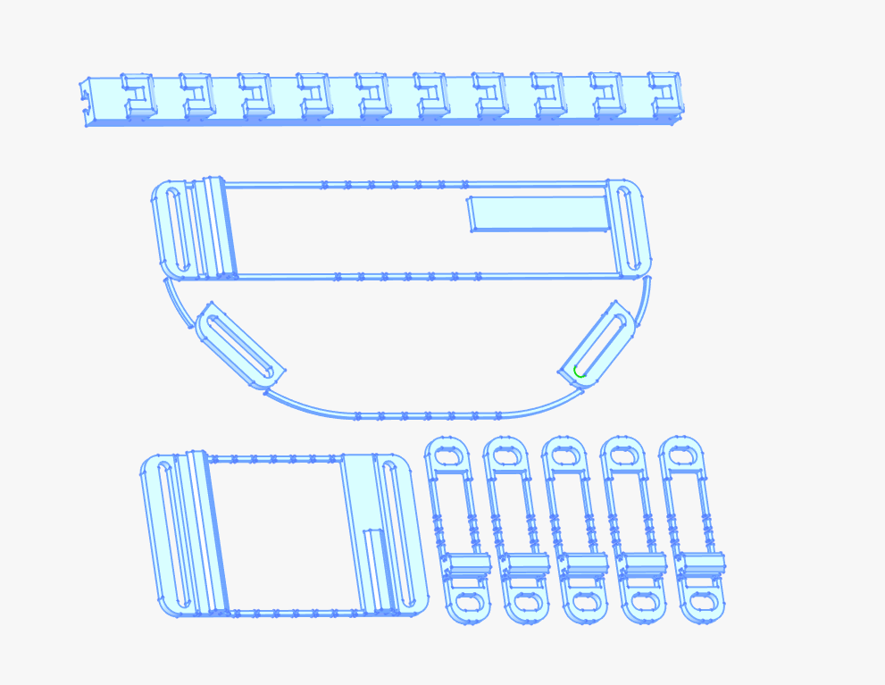

**01 间隔设计不抗撕裂问题**

因为间隔的虚线不支持网纱抗撕裂，所以我们还是得用实线。测试发现，0.8mm 的 PLA 能比较好的弯折，增强纱布的抗撕裂能力，1mm PLA 开始变脆，更容易在弯折中断裂。

后续设计中，会频繁采用0.8mm 厚度的 PLA 条做 “骨架”。 

在比赛场中，使用0.8mm厚度的 PLA 是可以直接弯折的，但容易断裂。有网纱支持的 0.8mm PLA 在柔性结构上会更可靠，更可塑形。

**02 小鱼际拉扯问题**

我们最终决定扩大小鱼际的受力范围。这种扩大面积的半圆形设计在体验后是舒适的，不会有压迫感。

**03 快拆卡扣结构**

块拆卡扣结构在 FreeCAD 上设计较为繁琐。原版设计在顶部会有许多倒角，但我们为了方便，仅使用左右两边的内切斜面，在前端并没有做斜面。但测试效果依旧可以满足固定要求。

**04 手心结构尝试**

我们在手心部分新增了一块厚片模拟手心结构。测试发现这部分可以很好的帮助到手型，可以有效防止手因为绑带而导致的弓起。

而且，因为手心凹陷的原因，这个部分的结构不会觉得特别突兀。是可选结构。

## 10-14号 第五版

第五版是在第四版的基础上做了很多性能测试，主要解决以下问题：

1. 手指适配性和免螺丝固定结构
2. 手掌尺寸适配性
3. 手腕拉力结构优化

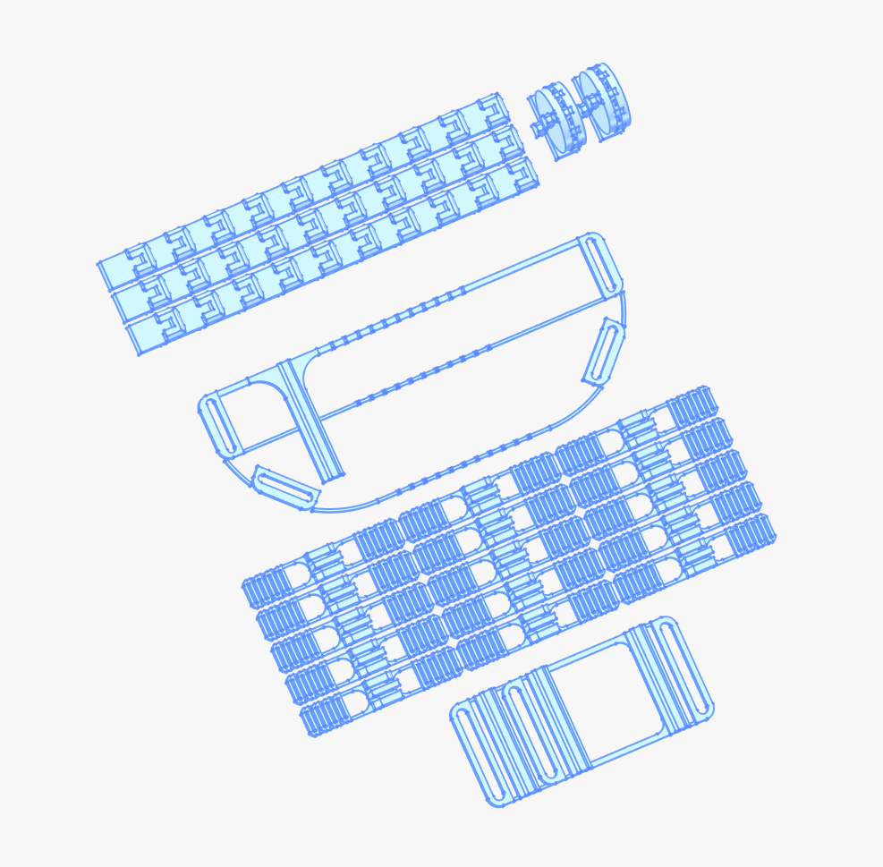

**01 手指适配性和免螺丝结构**

因为上面测试下来，发现 0.8mm 的PLA能比较好的形变，所以，在手部设计中，我们阵列化了绑带固定的部分。这样可以适配宽大的手指，如果需要适配小手指，只需要剪掉多余的阵列即可。

原版的手部结构是需要拧螺丝的。

为了进一步降低材料需求，这里设计了 S 型扣，弹力皮筋可以被较好的固定在内。

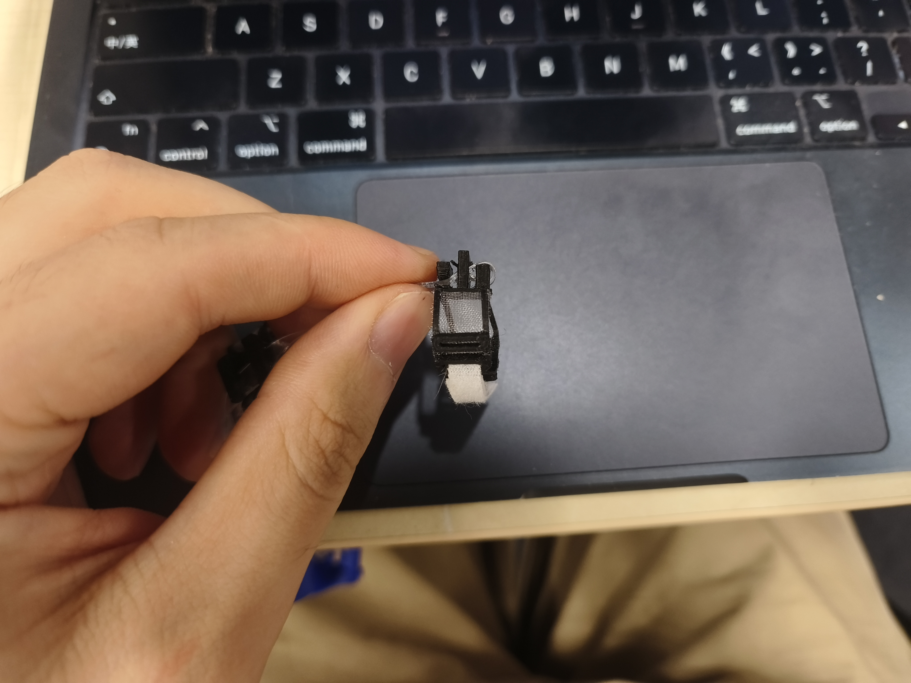

需要注意的是，这个版本的免螺丝弹力绳固定方案比较好，后面尝试了其他结构，都非常容易断裂。

我们这里的结构，左右两边都是悬梁，需要添加支撑。而中间则是一个5mm左右的桥接。所以，对于3D打印机本身的设置有要求。不然，如果中间还要加支持，拆除会异常麻烦。

**02 手掌尺寸适配性**

经过测量，现在版本的 130mm 长度的手腕设计是一个比较友好的设计，可以兼顾小手。这个部分只能小不能大。大手能适配小手，但是小手不能适配大手。

**03 手腕拉力结构优化**

手腕和手指一样使用了阵列扩大适配尺寸。

同时添加了圆弧以分摊拉力导致的应力集中。

## 黑客松版本 10月17号

黑客松中收到了一个新需求。就是更新手指结构。

无论是旧版还是我上面的版本，手指的拉力都是通过顶部弹力绳传导。但是这样会造成压力集中，在指背产生巨大的压强。佩戴非常不舒适。

艾力和大卫老师表示最开始有一套手指非常舒适，最后找到是这一套：[**改善精细运动技能的3D打印矫形器**](https://makerworld.com.cn/zh/models/162956-gai-shan-jing-xi-yun-dong-ji-neng-de-3dda-yin-jiao#profileId-77173)（比赛中未找到）

我们并没有完成这个新设计。但我们的考量如下：

1. 具有两档指关节，构成弹力绳的走线槽位。
2. 无螺丝辅助
3. 薄
4. 多手型适配

我们没有实现的是第一点。

我们的尝试如下：

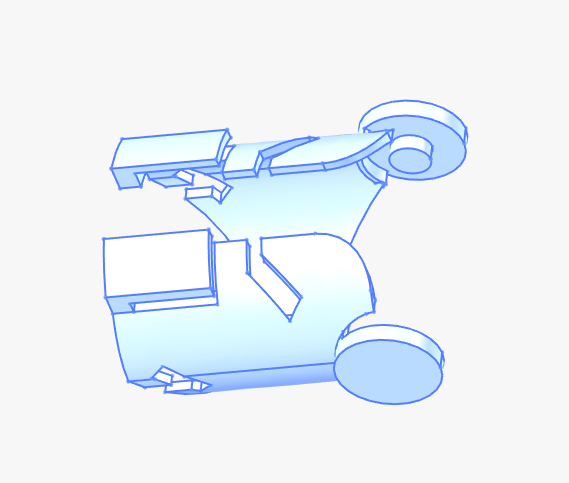

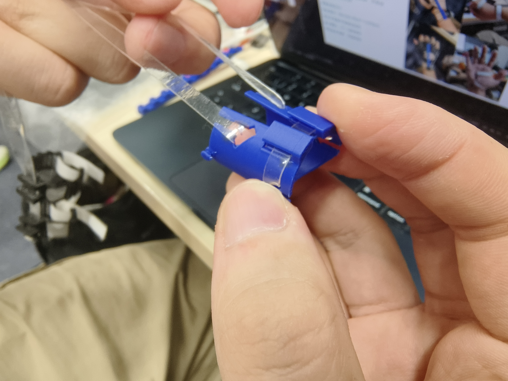

我们使用了 1 mm 厚的 PLA 打印。非常薄。而且拉力效果非常好。它的受力其实是从手指两侧偏下方受力，不会有明显的勒感。

但不知道是不是太薄了，导致我们的联动结构一直没能设计完成。

另外，测试过程中发现，我们的皮筋不能大面积接触用户皮肤，因为皮筋产生拉力形变会拉扯皮肤，产生强大的摩擦力，非常不舒适。